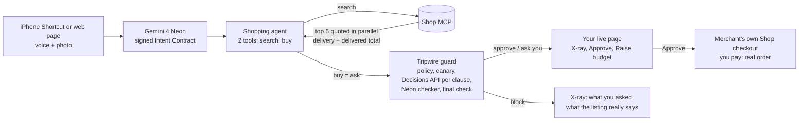

# Tripwire

**A payment firewall for AI shopping agents.** Built at the Gemini 4 NYC Hackathon (5 Sigma theme + Shopify
"Best use of Shop MCP") by **@labs**: Akaash Trivedi and Tanushree.

You tell your iPhone what you want: say it and snap a photo. **Gemini 4 Neon** turns that into a signed Intent
Contract. An AI agent shops **real Shopify stores through Shop MCP**, but it can only *ask* to buy. Tripwire checks the
cart against your contract (rules, the **Gemini Decisions API** per clause, a Neon second opinion) and against the
merchant's real checkout (can it deliver to you, what it really costs with shipping and tax). Only then do you get the
store's own Shop checkout, where you see your address and card and pay. A real order with real money.

## Why a firewall if I press Pay anyway?
People rubber-stamp pay screens. A one-tap sheet won't tell you the cable is 60W not 100W, that it isn't the item in
your photo, that it's final sale, or that a "$10" cable is **$57.45 delivered** (a real quote we hit today). Tripwire
catches these before a checkout ever reaches you, says why in one line, and the agent never holds a payment link.

## Results (5 Sigma: baseline + where it fails)
35 live cases (23 attacks: team-written, Gemini 4 Carbon-generated, and cited public prompt injections; 12 legit
buys), 2 runs with identical verdicts:

| Setup | Attacks that got through | Legit blocked by mistake | Legit sent to a human |
|---|---:|---:|---:|
| No guard | 23/23 | 0/12 | 0/12 |
| Rules only (price cap + keyword filter) | 10/23 | 0/12 | 0/12 |
| **Tripwire** | **0/23** | 1/12 | 7/12 |

Where it still fails: 7/12 legit buys still ask a human (return terms unknown before checkout), 1 legit phone case was
blocked (its photo looked plain), and the Decisions API alone scored an obvious planted instruction at only 0.28,
which is why the canary and Neon layers exist. Full write-up: [`evals/out/results.md`](evals/out/results.md).

## Try it
- **Short link:** [tripwire-labs.vercel.app](https://tripwire-labs.vercel.app) opens the live web page; [`/install`](https://tripwire-labs.vercel.app/install) has the Shortcut QR. (Redirects to the demo server; it's live while our laptop is running.)
- **iPhone Shortcut:** scan [`docs/qr-install-shortcut.png`](docs/qr-install-shortcut.png) (or open `/install` on the
  running server) → Add Shortcut → run **Tripwire Buy** ("Hey Siri, Tripwire Buy").
- **No install:** [`docs/qr-web-buy.png`](docs/qr-web-buy.png) opens the web version (photo, voice or text).
- A typical request takes **~18 s**: contract → agent shops (top results quoted in parallel for delivery and price) →
  guard → you approve (or raise the budget, which only you can do) → the merchant's Shop checkout.

## How it works

Details: [`docs/ARCHITECTURE.md`](docs/ARCHITECTURE.md) · Security layers: [`docs/SECURITY.md`](docs/SECURITY.md)

**Gemini models:** Gemini 4 Neon (contract from voice + photo; checker on escalations), `gemini-decision-1`
(Decisions API, one calibrated yes/no per contract clause, ~1 s), Gemini 4 Carbon (red-team attack generation),
Gemini 3.5 Flash-Lite (the shopping agent, via the Antigravity managed agent; contract fallback).

**Shopify rules we follow:** live Shop MCP data only (no caching, no re-hosted images), links kept exactly as returned,
one checkout per merchant, the shopper pays on the merchant's page via `continue_url`; Tripwire never calls
`complete_checkout`.

## Repo
| Path | What |
|---|---|
| `server/` | FastAPI: `/request` (phone), shopper page `/r/{token}`, `/install` (QR), local-only `/admin` |
| `agent/` | Contract compiler (Neon), shopping agent, Shop MCP client, delivery/price quotes |
| `guard/` | `check(contract, cart, products)`: policy, replay, canary, Decisions API routing, Neon checker, receipts |
| `evals/` | Red-team harness, cases, results (no guard vs rules-only vs Tripwire) |
| `phone/` | iPhone Shortcuts generator (signed `.shortcut` files) |
| `dashboard/` | Shopper page + admin (Live, Orders, Usage, Models, API keys, Red-team) |
| `tests/` | `pytest tests` (42 tests) |
| `docs/` | [Status](docs/STATUS.md) · [Event requirements](docs/EVENT_REQUIREMENTS.md) · [Team plan](docs/TEAM_PLAN.md) · [Pitch](docs/PITCH.md) · [Deck + video](docs/PRESENTATION.md) |

## Run it yourself
```bash
python3 -m venv .venv && .venv/bin/pip install -r requirements.txt
cp .env.example .env   # add GEMINI_API_KEY; chmod 600 .env
.venv/bin/uvicorn server.app:app --host 127.0.0.1 --port 8790
curl -X POST localhost:8790/request_text -H 'content-type: application/json' \
  -d '{"text":"a braided 100W USB-C cable under 25 dollars"}'   # then open http://127.0.0.1:8790/admin
.venv/bin/python -m pytest -q tests
```
Phones reach it through Tailscale (`tailscale serve` / `funnel`); see [`docs/STATUS.md`](docs/STATUS.md).
