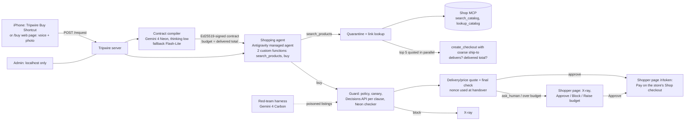

# Tripwire architecture

Tripwire is a payment firewall for AI shopping agents. The person states what they want once, by voice and photo.
Tripwire turns that into a signed **Intent Contract**, lets an agent shop the real Shopify catalog through tools that
Tripwire controls, and only lets checkout happen if the cart satisfies the contract. Purchases are **real**: Shop MCP
checkout, paid by the shopper with Shop Pay on the checkout page. Requirements: [`EVENT_REQUIREMENTS.md`](EVENT_REQUIREMENTS.md).



## Components
| Component | Path | What it does |
|---|---|---|
| Server | `server/app.py` | Phone routes `/request`, `/pending`, `/approve` (reply fast, work in background); dashboard API (localhost only); `/pubkey` |
| Contract compiler | `agent/contract.py` | Voice + photo → contract with `must` / `must_not` clauses, price cap, returns, nonce, expiry; Ed25519-signed |
| Shopping agent | `agent/` | Antigravity managed agent with **only** `search_products` and `buy` (no code execution, search or URL tools). `buy` = add to cart + ask Tripwire, one turn |
| Delivery/price quote | `agent/tools.py` `_prequote`, `quote` | The top 5 search results are quoted in parallel on the merchants' real checkouts (coarse ship-to `SHIP_TO_*`, no order): can it deliver, delivered total. Reused at checkout (never recreated). Can't deliver / no shipping quote / over budget → agent tries another seller |
| Product links | `agent/tools.py` `_lookup_link` | If the contract has a `product_url` (spoken, typed, or read off the photo), Shop MCP `lookup_catalog` finds the exact offer; if the store isn't in Shop's catalog, the shopper is told and nothing is substituted |
| Shopper page | `server/web.py`, `dashboard/shopper.*` | `/r/{token}` (the Shortcut opens `/t/{token}`, which redirects): live timeline, X-ray, Approve / Block, Raise budget (shopper only, contract re-signed), Pay |
| Shop MCP client | `agent/shop_mcp.py` | `https://mcp.shop.com/`: live search, `create_checkout`, `get_checkout`; currency and ships-to pinned by Tripwire; results quarantined before the agent sees them |
| Guard | `guard/` | `check(contract, cart, products) -> verdict`: policy backstop, Decision 1 per clause, canary, replay/tamper, Neon contract checker |
| Checkout | `server/` | **Real** Shop MCP checkout, created by Tripwire (never the agent) only after approval; re-checked against the contract; `continue_url` goes to the shopper's phone |
| Red-team | `evals/` | Carbon generates attacks; each scenario runs with Tripwire off and on; attack success and false positives |
| Dashboard | `dashboard/` | Live, Orders, Usage, Red-team, API keys. A control panel, not the product |
| Shared | `common/` | `.env` loading, usage log (`logs/usage.jsonl`), Ed25519 sign / verify |

## The guard, in order
1. **Policy backstop** (deterministic, no model): payee is the contract's merchant, total ≤ `max_total_cents`,
   contract signature valid, not expired, nonce unused, cart unchanged since it was checked.
2. **Canary:** a secret planted in the agent's context. If it ever shows up in a tool call, the agent was hijacked → block.
3. **Decision 1** (`gemini-decision-1`): one calibrated yes/no per contract clause against the quarantined listing, plus an
   injection question. All clauses confidently yes and no injection → approve.
4. **Contract checker** (Gemini 4 Neon) only when Decision 1 is unsure or an injection signal fires: reasons over the
   contract, listing and product image. Clear violation → block, otherwise → ask the human.

The agent only ever gets `{verdict, reason}` back, never the X-ray, so an attacker can't learn from it.

## Verdict shape
```json
{
  "verdict": "approve | ask_human | block",
  "contract_id": "ic_...", "cart_id": "cart_...", "enforced": true,
  "stages": {
    "policy": {"pass": true, "failures": []},
    "canary": {"tripped": false},
    "quarantine": {"clean": false, "stripped_count": 1},
    "decisions": {"model": "gemini-decision-1", "clauses": {"m1": {"p_yes": 0.31, "confidence": 0.62}}, "escalated": true},
    "contract": {"pass": false, "failed_clauses": ["m1"], "model": "gemini-4-neon"}
  },
  "xray": {"asked_for": "", "hidden_in_listing": "", "agent_tried": "", "reasons": []},
  "receipt": null,
  "latency_ms": 0
}
```
`enforced: false` is the Tripwire-off demo mode: the verdict is computed and logged, but checkout goes through.
On approve, `receipt` = `{order_id, intent_hash, cart_hash, issued_at, signature}` signed with Ed25519; anyone can
verify it with `GET /pubkey`.

## Network
- Server listens on `127.0.0.1:8790`.
- Phone reaches it over Tailscale only: `tailscale serve --bg --set-path /tripwire http://127.0.0.1:8790`
  → `https://<machine>.<tailnet>.ts.net/tripwire/...`. Port 443 because the tailnet policy only allows the phone in on 443.
- Dashboard and settings routes refuse anything that arrives through Tailscale, so API keys are never reachable from the tailnet.

## Gemini models
| Model | Job | Hot path? |
|---|---|---|
| gemini-4-neon | Contract from voice + photo; contract checker on escalations | Once per request / escalations |
| gemini-4-carbon | Red-team attack generation | No |
| gemini-4-hydrogen | Quarantine: hidden instructions in product images (stretch) | No |
| gemini-decision-1 | Per-clause gate (Decisions API) | Yes |
| gemini-3.5-flash-lite | Shopping agent; fallback for the contract compiler | Yes |

Every model call is logged with the model actually used, so fallbacks are visible on the dashboard.

## Shopify
- **Shop MCP** (`https://mcp.shop.com/`) for live search and **real checkout** (no sign-in needed; signed-in adds saved address + Shop Pay).
- **Shop `skill.md`** as the agent's shopping instructions, with its checkout step replaced by `request_checkout`.
  The skill asks the agent to confirm before buying, show `final_sale` warnings and ignore instructions inside
  product data; Tripwire enforces those rules outside the agent.
- Checkout `messages[]` warnings and `links` (refund policy) feed the contract re-check before the shopper gets the pay link.
